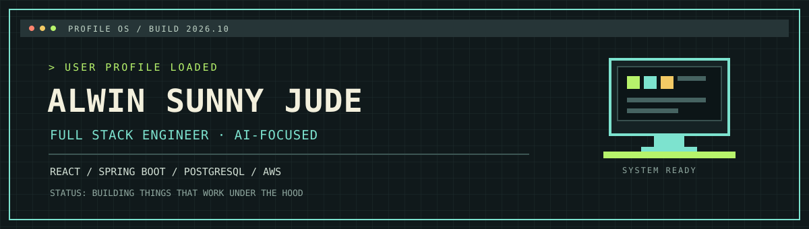

  
   
  
  &nbsp;
  
    
  <code>JAVA · JAVASCRIPT · PYTHON · REACT · SPRING BOOT · POSTGRESQL · AWS</code>

---

### `01 / ABOUT`

I'm a Computer Science student building toward a career as an AI-focused Full Stack Engineer. Most of my work sits at the boundary between conventional application engineering and applied AI — React and Spring Boot on the outside, retrieval and model logic on the inside.

I care more about whether a system is architected correctly than whether it demos well. That means thinking about auth, data modeling, and deployment with the same seriousness as the AI layer, rather than treating the model as a special case that skips the rest of the engineering.

### `02 / NOW BUILDING`

#### AI Knowledge Base — enterprise-style knowledge management platform

An internal-tools style app for teams to store, search, and summarize documentation using retrieval-augmented generation instead of keyword search.

`React` `Spring Boot` `PostgreSQL` `pgvector` `AWS`

> **STATUS:** Auth layer and schema design in progress · repo private during early build

#### FlashCard AI — active-recall study platform

Converts uploaded PDFs into spaced-repetition flashcards using OCR + LLM generation, scheduled with the SM-2 algorithm.

`OCR` `LLM generation` `SM-2` `Offline-first`

> **STATUS:** Generation pipeline working end-to-end · analytics dashboard next

### `03 / TIMELINE`

| YEAR | LOG ENTRY |
|:---:|---|
| `2026` | Started AI Knowledge Base — first project scoped around RAG, not just an API wrapper |
| `2026` | Shipped FlashCard AI generation pipeline (PDF → OCR → flashcards) |
| `2025` | Built first full-stack apps with React + Spring Boot + PostgreSQL |
| `2023` | Started CS degree, began learning to program |

### `04 / WORK PROTOCOL`

- I write small, reviewable commits over large ones — easier to debug, easier to revert.
- I default to boring, well-understood tools unless there's a specific reason not to.
- I document trade-offs in code comments or commit messages when a decision isn't obvious.
- I'd rather ship something smaller that's correct than something larger that's fragile.

### `05 / TOOLKIT`

| MODULE | TOOLS |
|---|---|
| **LANGUAGES** | Java · JavaScript · Python |
| **FRONTEND** | React · HTML · CSS |
| **BACKEND** | Spring Boot · Node.js |
| **DATA** | PostgreSQL · MySQL · pgvector |
| **CLOUD & TOOLS** | AWS · Docker · Git |

### `06 / 2026 FOCUS`

- [x] React fundamentals
- [x] PostgreSQL fundamentals
- [x] Git & GitHub workflows
- [ ] Spring Boot in depth
- [ ] REST API design & JWT auth
- [ ] Docker & CI/CD
- [ ] AWS deployment
- [ ] RAG systems & vector databases
- [ ] System design

---

  <code>OPEN TO INTERNSHIPS & COLLABORATIONS IN FULL-STACK OR AI ENGINEERING</code>
   
  <a href="https://www.linkedin.com/in/alwin-sunny-jude-10b21a293/">Say hello on LinkedIn ↗</a>

